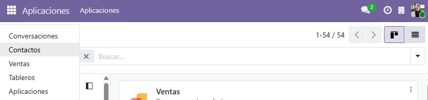
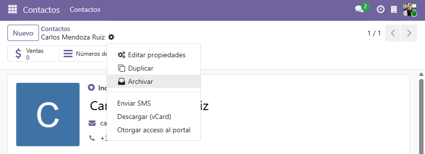

## Tipos de usuario en Odoo y asignación

### Definición de tipos de usuario

Odoo clasifica los accesos al sistema en tres niveles diferenciados según la relación que la persona mantiene con la
organización:

* **Usuario Interno:** Empleados y personal operativo de la empresa. Disponen de acceso al *backend*
  (panel de gestión) y a las aplicaciones de negocio según los permisos asignados a su puesto. Operan directamente sobre
  el flujo de trabajo interno.
* **Usuario Portal:** Clientes, socios o proveedores externos. No tienen acceso a la interfaz de gestión
  ni a la base de datos interna. Acceden a un área web privada y restringida con el principio de mínimo
  privilegio estricto: solo pueden consultar, firmar o descargar sus propios documentos (presupuestos, pedidos,
  facturas) sin interactuar con los datos de otros clientes ni ver la operativa del gimnasio.
* **Usuario Público:** Visitantes anónimos que navegan por el sitio web o catálogo público sin haberse
  autenticado. Tienen exclusivamente permisos de lectura sobre información pública y no pueden realizar gestiones
  internas.

---

### Asignación en FitZone S.L.

| Usuario                 | Puesto / Rol                  | Tipo de Usuario | Grupos / Privilegios por módulo                                                                                                         | Justificación                                                                                                                                                                                         |
|:------------------------|:------------------------------|:---------------:|:----------------------------------------------------------------------------------------------------------------------------------------|:------------------------------------------------------------------------------------------------------------------------------------------------------------------------------------------------------|
| **David**               | Responsable de Ventas         |   **Interno**   | • **Ventas:** Administrador • **Contactos:** Acceso completo • **Administración:** Ajustes de acceso                              | Empleado del gimnasio. Requiere acceso al *backend* de Ventas para supervisar, auditar y validar presupuestos y pedidos comerciales de toda la plantilla.                                             |
| **Laura Gómez**         | Comercial / Recepción         |   **Interno**   | • **Ventas:** FitZone / Comercial junior *(personalizado)* • **Contactos:** FitZone / Comercial junior • **Facturación:** Ninguno | Empleada del gimnasio. Requiere acceso al *backend* para atender en mostrador, registrar socios y tramitar sus propios pedidos de venta sin alterar tarifas ni borrar contactos.                      |
| **Elena Martín**        | Administración / Facturación  |   **Interno**   | • **Facturación / Contabilidad:** Administrador / Facturación • **Contactos:** Acceso completo • **Ventas:** Ninguno              | Empleada del gimnasio. Requiere acceso al *backend* de Facturación para emitir facturas, controlar vencimientos y registrar cobros.                                                                   |
| **Carlos Mendoza Ruiz** | Socio (Cliente B2C)           |   **Portal**    | • **Portal web (`/my`):** Solo lectura de sus registros propios                                                                         | Cliente externo. No debe tener visibilidad sobre el sistema interno. Su acceso portal le permite consultar el estado de su cuota mensual, revisar sus bonos y descargar facturas en PDF desde la web. |
| **Visitante Web**       | Prospecto / Visitante anónimo |   **Público**   | • **Sitio Web:** Acceso público de lectura                                                                                              | Usuario no registrado que consulta en la web pública los horarios, servicios o instalaciones de FitZone.                                                                                              |

---

## Detalle del Grupo Personalizado: `FitZone / Comercial junior`

Para cubrir las necesidades del personal de recepción y ventas júnior, se ha diseñado un grupo de seguridad a medida en
el módulo de Ventas.

### Configuración general y herencia

* **Nombre técnico/visible:** `FitZone / Comercial junior`
* **Aplicación / Categoría:** `Ventas`
* **Usuario asignado:** Laura Gómez (`laura.comercial@fitzone.es`)
* **Grupos heredados (Grupos implicados):**
    * `Ventas / Usuario: Solo mostrar documentos propios` (hereda a su vez internamente la condición de
      `Base / Usuario interno`).

### Derechos de acceso sobre modelos (Access Rights)

Se han configurado permisos a nivel de tabla sobre los modelos críticos de negocio, controlando las operaciones básicas
(Lectura, Escritura, Creación y Borrado):

| Modelo técnico     | Descripción del modelo           | Lectura (L) | Escritura (E) | Creación (C) | Borrado (B) | Justificación de seguridad                                                                                                             |
|:-------------------|:---------------------------------|:-----------:|:-------------:|:------------:|:-----------:|:---------------------------------------------------------------------------------------------------------------------------------------|
| `product.template` | Plantilla de producto / Producto |   **Sí**    |    **No**     |    **No**    |   **No**    | Permite consultar el catálogo y precios de cuotas/bonos para presupuestar, impidiendo alterar costes o crear artículos no homologados. |
| `res.partner`      | Contacto / Cliente               |   **Sí**    |    **Sí**     |    **Sí**    |   **No**    | Permite registrar nuevos socios en recepción y actualizar datos de contacto, denegando de forma estricta la eliminación de registros.  |

### Reglas de registro y menús asociados

* **Regla de registro (*Record Rule*):**
    * **Nombre:** `FitZone: Solo modificar contactos propios`
    * **Modelo:** `res.partner` (*Contacto*)
    * **Filtro de dominio:** `['|', ('user_id', '=', user.id), ('user_id', '=', False)]`
    * **Permisos aplicados:** Escritura y Creación activas; Lectura y Borrado restringidas a nivel global. Permite
      editar únicamente socios asignados directamente a su usuario o fichas sin comercial asignado.
* **Menús vinculados:** Acceso restringido exclusivamente a las vistas de **Ventas / Presupuestos** y **Contactos**.

---

## Demostración y comprobación de permisos

### Pruebas de acceso: Laura Gómez (Comercial junior)

Se accede a Odoo con las credenciales de Laura Gómez (`laura.comercial@fitzone.es`) para validar las restricciones
impuestas por el grupo `FitZone / Comercial junior`:

1. **Restricción de aplicaciones visibles:**
   Se comprueba que la usuaria únicamente tiene acceso a los módulos operativos autorizados (**Ventas** y
   **Contactos**), sin visibilidad sobre **Facturación/Contabilidad** ni sobre la configuración general del sistema
   (**Ajustes**).

   

2. **Restricción de eliminación sobre registros:**
   Al acceder a la ficha de un cliente en **Contactos** y desplegar el menú de acciones, se verifica que la opción de
   borrado (**Suprimir / Eliminar**) no se encuentra disponible, impidiendo la pérdida accidental de datos en la base de
   socios.

   